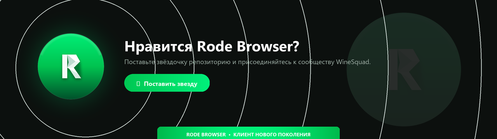

<div align="center">



# 🚀 Rode Browser

**Сверхбыстрый, ультралегковесный браузер на базе Tauri v2 + Win32 C++ FFI**

[](https://t.me/WineSquad)
[](https://github.com/nanodevmc/Rode-Browser/releases)
[](LICENSE)

</div>

## ✨ Ключевые особенности
- **Нативный рендер Chromium (WebView2)**: 100% совместимость с современными веб-стандартами (ES2024, WebAssembly, WebGL, CSS Grid), полноценная работа с Google, GitHub, YouTube и Telegram без ограничений безопасности iframe.
- **Минимальное потребление ресурсов**: потребление процессора < 5% благодаря вырезанию тяжелых визуальных фильтров размытия и оптимизированному плоскому Liquid Glass интерфейсу.
- **Нативный C++ модуль (Win32)**: системная регистрация браузера по умолчанию (`http`, `https`, `.html`, `.htm`) напрямую в реестре Windows (`HKCU`).
- **Интеллектуальная гибернация вкладок**: неактивные вкладки моментально замораживают рендер и JS-таймеры, высвобождая ОЗУ и разгружая потоки процессора.
- **Встроенный AdBlock & Трекер-блокер**: фильтрация рекламных скриптов и телеметрии на уровне O(1) хэш-таблиц до отправки сетевых запросов.
- **Speed Dial (Новая вкладка)**: домашний экран с часами, быстрым поиском и стеклянными плитками быстрого доступа.
- **Горячие клавиши**: `Ctrl+T`, `Ctrl+W`, `Ctrl+L`, `Ctrl+D`, `Ctrl+H`, `F5`.

## 🛠 Сборка и запуск
Требования: Node.js, Rust/Cargo, MSVC Build Tools.

```cmd
npm install
npx tauri dev
```

Сборка легковесного NSIS-инсталлера:
```cmd
npx tauri build
```
Готовый установщик: `src-tauri/target/release/bundle/nsis/RodeBrowser_1.0.0_x64-setup.exe`.
